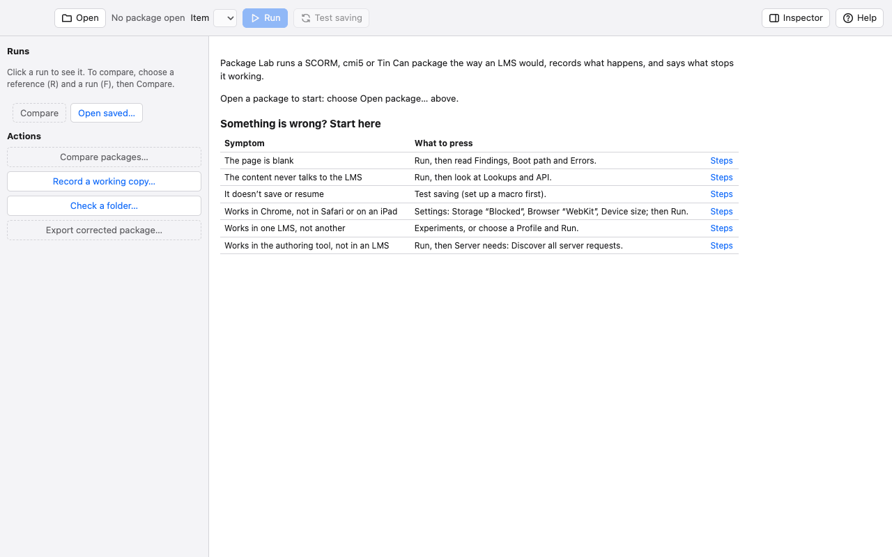
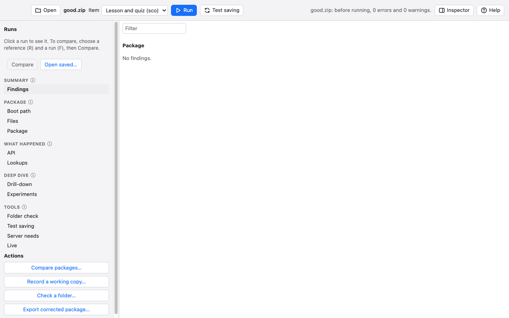
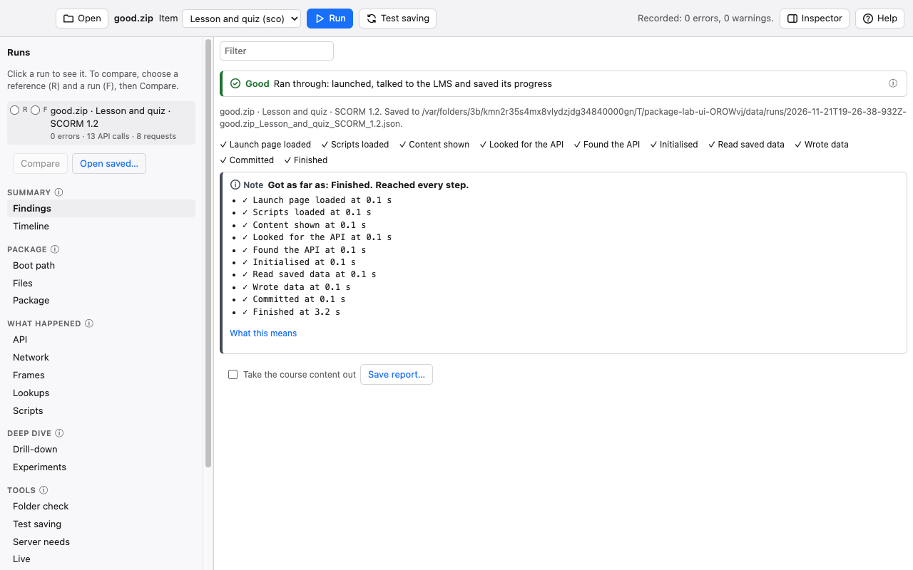
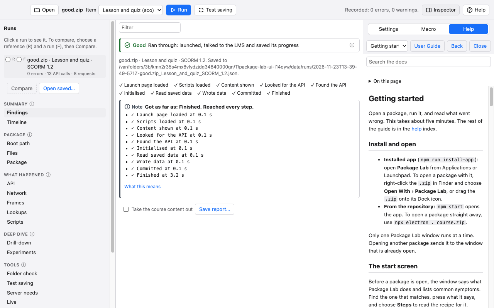

# Getting started

Open a package, run it, and read what went wrong. This takes about five minutes. The rest of the guide is in the [user guide](../user-guide.md) index.

## Install and open

- **Installed app** (`npm run install-app`): open **Package Lab** from Applications, Launchpad or Alfred. To open a package with it, right-click the `.zip` in Finder and choose **Open With › Package Lab**, or drag the `.zip` onto its Dock icon.
- **From the repository:** `npm start` opens the app. To open a package straight away, use `npx electron . course.zip`.

Only one Package Lab window runs at a time. Opening another package sends it to the window that is already open.

## The start screen

Before a package is open, the window says what Package Lab does and lists common symptoms. Find the one that matches, press what it says, and choose **Steps** to read the recipe for it.

| Symptom | What to press | Steps |
|---|---|---|
| The page is blank | Run, then read **Findings**, **Boot path** and **Errors** | [Steps](../recipes.md#shows-a-blank-page) |
| The content never talks to the LMS | Run, then look at **Lookups** and **API** | [Steps](../recipes.md#no-api-calls) |
| It doesn't save or resume | **Test saving** (set up a macro first) | [Steps](../recipes.md#doesnt-resume) |
| Works in Chrome, not in Safari or on an iPad | **Settings**: Storage “Blocked”, Browser “WebKit”, Device size; then **Run** | [Steps](../recipes.md#works-in-chrome-not-in-safari-or-on-an-ipad) |
| Works in one LMS, not another | **Experiments**, or choose a **Profile** and **Run** | [Steps](../recipes.md#works-in-one-lms-not-another) |
| Works in the authoring tool, not in an LMS | Run, then **Server needs**: Discover all server requests | [Steps](../recipes.md#works-on-the-authoring-platform-not-in-an-lms) |

## The menus

On the desktop, the menu bar has the toolbar's actions and a few more. On Windows, Ctrl replaces ⌘ and Alt replaces ⌥ in every shortcut. Reload is ⇧⌥⌘R, so ⌘R is **Run**, and Developer Tools is ⇧⌥⌘I, so ⌥⌘I is **Show Inspector**.

| Menu | Items |
|---|---|
| **Package Lab** | **Settings…** ⌘, (see [Settings](#settings)) |
| **File** | **Open Package…** ⌘O, **Open Recent**, **Compare Packages…**, **Check a Folder…**, **Open Saved Run…**, **Record a Working Copy…**, **Export Corrected Package…** ⌘E |
| **Run** | **Run** ⌘R, **Stop** ⌘., **Record Macro** ⌥⌘R, **Test Saving** ⇧⌘R |
| **View** | **Show Inspector** ⌥⌘I, **Reload** ⇧⌥⌘R |
| **Help** | **Show Docs** ⇧⌘H, **User Guide**, **Recipes**, **Findings**, **Show Data Folder** (opens `~/Library/Application Support/Package Lab`) |

## The window at a glance

- **Toolbar**, in the title bar on a Mac: **Open package** and the package's name, the **Item** to run, **Run** (⌘R; it becomes **Stop** while a run goes, ⌘.), **Record** (while a run goes) and **Test saving**, the status line, then **Inspector** (⌥⌘I) and **Help**. Beside Run, a **summary chip** lists the settings that aren't at their defaults (for example "SCORM 2004, Moodle, iPhone"). Click it to open them; it is hidden when everything is at its default. Buttons show a label as well as an icon when the window is 1,100 pixels wide or more. Drag the empty part of the toolbar to move the window. On a Mac the controls use your system accent colour.
- **Sidebar** (left): **Runs**, the views in five groups, then **Actions**. See [Views](views.md).
- **Inspector** (right, ⌥⌘I): **Settings**, **Macro** and **Help**. See [Run settings](run-settings.md) and [Macros and test saving](macros.md).

## Open a package

Choose **Open package…** and pick the `.zip`. Package Lab reads it in memory; nothing is unpacked to disk. **Findings** fills at once with what can be told from the files, and the status line counts the errors and warnings. **File › Open Recent** lists packages you opened before.

You can also drag the `.zip` from Finder onto the window. A **Drop to open** overlay shows while the file is over the window, and the package opens when you let go. In the web interface the file is uploaded to the Mac running Package Lab. Dropping any other kind of file shows *Only .zip packages can be opened* and changes nothing.

The package is checked like this:

- The manifest must be called `imsmanifest.xml`, in lower case, at the top of the ZIP.
- Each resource's launch file and listed files must exist with exactly the same capitals.
- The manifest's SCORM version must match the API the scripts use.

## Run it

1. Choose the **Item**: the first SCO is selected for you.
2. For a first run, leave the settings as they are. They are in the inspector; [Run settings](run-settings.md) says what each one does.
3. Choose **Stop after** under **Settings › Recording**: **I stop it** if you will use the course yourself, or a time, after which Package Lab stops and analyses by itself.
4. Choose **Run**. The course opens in its own window, with Package Lab as the LMS. The **API** view fills in live.
5. Use the course as a learner would: go through a few pages and answer a question. To test saving, leave it the normal way, with its exit or close button.
6. Choose **Stop**, or close the course window.

Package Lab then collects code coverage and scripts, works out the findings, saves the run and selects it.

## Read the verdict

Start with **Findings**. A banner at the top says how the run went, with one word and one sentence: **Problem**, **Warning** or **Good**, then “Got as far as “…”, but didn’t reach “…”.” The word is the worst finding's, so **Good** means there was no problem and no warning. Under the banner come the **Milestones** strip and then the findings, worst first. [Reading a run](reading-a-run.md) explains each part.

## Settings

**Package Lab › Settings…** (⌘,) has two settings:

- **Appearance**: **System** (the default), **Light** or **Dark**. It applies at once. See [Appearance](run-settings.md#appearance).
- **Web interface port** (1024 to 65535; 4880 unless changed): the port the [web interface](../web.md) listens on. **Reset to default** fills in 4880, and **Save port** keeps it.

Save port checks the port. A value outside the range is refused with a message. If something is already listening on the port, the port is saved anyway, with a warning, and the dialog stays open. A new port takes effect the next time the web interface starts. **Close** shuts the dialog without saving the port.

The settings are kept in `settings.json` in the data folder (`~/Library/Application Support/Package Lab`). The web interface's **Settings** button has only the Appearance, and keeps it in that browser.

## The docs panel

**Help** (at the right end of the toolbar, or **Show Docs** in the Help menu) opens the docs in the **Help** segment of the inspector. Choose a doc from the list, which is grouped as Guide, Recipes and findings, Reference and Authoring tools. **Back** returns to the doc you were reading, and **Close** shuts the inspector. Links to other docs open there; web links open in your browser. Package Lab remembers which doc it showed.

The **Search the docs** field at the top searches every doc as you type, up to 20 results. Each shows the doc, the heading above the match and the words around it. Click one to open that heading. **On this page** lists the open doc's headings. The small **ⓘ** beside a Settings group, a view group in the sidebar, the Storage setting and the verdict on Findings opens the part of the guide that explains it.

The docs are bundled in the app, so they work offline. The web interface has the panel too.

## Privacy

Package Lab never sends package content anywhere:

- the package is served from memory to Package Lab's own browser;
- requests the content makes to other sites go out as they would in any browser, and the Network view shows them;
- saved runs stay in your Library folder;
- reports say they were made on this computer.

## Troubleshooting

- **Nothing happens when I launch.** Look at the status line. A package without a readable manifest can't be launched.
- **The course window is blank and there are no findings.** Stop, so the run is analysed: the launch findings explain what didn't load.
- **Too many caught errors, or the course is slow.** Turn off **Record caught errors** (under **Settings › Recording**).
- **A course needs a sign-in or licence server.** Its requests show in **Network**. If they fail, that is a finding in itself: the package depends on a server.
- **Electron couldn't be found.** Run `npm install` in the repo.
- **WebKit says Playwright isn't installed.** See [Browser and device](run-settings.md#browser-and-device).

## On the command line

`package-lab open course.zip` opens the app with a package, using the installed app if there is one. The [command line reference](../cli.md#open) covers it, [the app's settings as flags](../cli.md#the-apps-settings-as-flags) lists the flag for each setting, and [settings](../cli.md#settings) shows and sets the web interface port.
