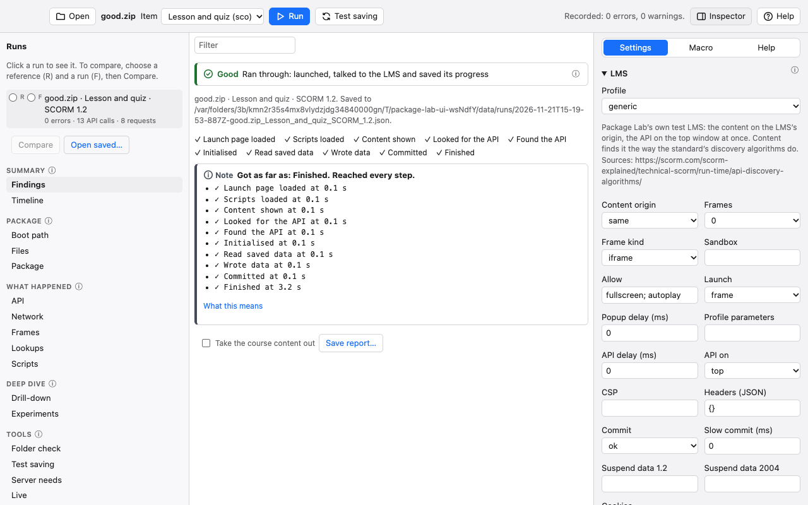

# Run settings

The settings the next run will use are in the inspector's **Settings** segment (⌥⌘I, then **Settings**), in four groups. All but **Advanced** start open. The summary chip beside **Run** lists the settings that aren't at their defaults; click it to open them here. The inspector remembers whether it is open, which segment it was on and its width: it starts 340 pixels wide, and you can drag its left edge or focus the edge and use the arrow keys.

Change one setting, run again, and see whether the content gets further.

## Testing a theory

| Setting | Group | What it changes | Tests |
|---|---|---|---|
| **API** | LMS | Which API objects the test LMS puts on its window: as the manifest says, both, 1.2 only, 2004 only, or none | **Both** working where **As the manifest says** didn't means the manifest declares the wrong SCORM version. **None** shows what the content does without an LMS (its standalone or preview path) |
| **Frame depth** | Advanced | Empty LMS frames between the API's window and the content (0–3) | Content that searches only a few parents fails at greater depth. Many LMSs put content 2–3 frames deep |
| **In a new window** | Advanced | The content opens with `window.open`, and finds the API through `window.opener` | Content that only searches parents fails in LMSs that launch in a new window |
| **Resume last run's data** | LMS | The data model starts with the values the last run stored | Whether the content reads back and uses its bookmark and suspend data |

**Frame depth** and **In a new window** go on top of the profile: a depth other than 0 replaces the profile's, and a new window puts the API on the opener.

## LMS

**Profile** hosts the content the way an LMS does. Some LMSs serve content from another domain, frame it several levels deep or in a sandbox, open it in a new window, put the API somewhere other than the top window, or only after a moment. A package that works here can fail in one of them for those reasons.

- **generic** is Package Lab's own test LMS, as it always was: the default.
- **moodle**, **scorm-cloud**, **cornerstone**, **successfactors**, **docebo**, **totara**, **blackboard** and **canvas** are approximations of what each LMS does by default, from its public documentation. Each one's notes show under the list, with the documents used. Where the documents don't say, a preset keeps the generic value and says so. An LMS's administrator can change most of these, so treat a preset as a likely setup, not a fact.

The profile fields show the chosen profile's values. Change any of them to try a variation; the run then uses the preset with your changes. Choosing another profile clears your changes.

| Field | What it does |
|---|---|
| **Content origin** | **same**: served from the LMS's origin (`https://lms.lab.invalid/`, shown as `lab://run/`). **other**: from another origin (`https://cdn.content.invalid/`, shown as `lab://content/`), as when an LMS serves packages from a separate domain or CDN. The content then can't read anything on the LMS's windows, the API included |
| **Frames**, **Frame kind** | How many empty LMS frames are between the LMS page and the content (0–5), and whether they are `iframe`s or a `frameset` with `frame`s |
| **Sandbox**, **Allow** | The `sandbox` and `allow` attributes of the content's own frame (iframes only). An empty sandbox means none. A sandbox without `allow-same-origin` gives the content an opaque origin |
| **Launch**, **Popup delay** | **frame**, or **popup**: the LMS opens the content with `window.open`, after the delay |
| **Profile parameters** | Query text the LMS adds to the launch address. `{scoid}` (the item's identifier), `{attempt}` (1, or 2 when resuming) and `{learner}` (`learner-1`) are filled in. **Launch parameters** (Advanced) are added after these |
| **API delay** | How long after the launch the API objects appear. Content that looks only once, at once, misses them |
| **API on** | Which window holds the API: **top** (the LMS page; in a popup, the new window's top LMS frame), **parent** (the content's parent frame) or **opener** (the window that opened the content: needs **popup**). With **popup**, **top** and **parent** need at least one frame |
| **CSP**, **Headers** | A `Content-Security-Policy` header, and other headers (a JSON object), on every package file |
| **Commit**, **Slow commit** | **ok**; **fail**: `LMSCommit`/`Commit` returns false with error 101 (1.2) or 391 (2004); **slow**: each commit blocks for the given time, like a slow synchronous save |
| **Suspend data 1.2**, **2004** | The LMS's own limit on `cmi.suspend_data`, in characters. Empty means the standard's (4,096 and 64,000) |
| **Cookies** | **normal** or **third-party-blocked**. With **third-party-blocked**, storage in the content's frames is blocked, as **Storage: Blocked** does. The **scorm-cloud** preset sets it |

The findings explain what a profile breaks. Content on another origin that looks for the API through its parents gets "The content can't reach the LMS from another origin", with each refused lookup and the line that made it. A sandbox without `allow-same-origin` gets "The LMS frame's sandbox has no allow-same-origin". Failing commits show under the API calls that failed. The run's label names the profile when it isn't generic, and the saved run keeps it.

To try every preset at once, run the **lms** experiment; see [Experiments](experiments-and-servers.md#experiments).

## Browser and device

A course that works in Chrome can fail in Safari or on an iPad, and work on a desktop but fail on a phone. Two settings let you try both.

**Browser** chooses the engine:

| Browser | What it is |
|---|---|
| **Chromium** | The browser inside Package Lab. Everything in this guide works. |
| **WebKit (Safari's engine)** | The engine Safari uses, run through Playwright. The content runs on the same test LMS, with the same files, changed files, pins, answers, profile and storage setting. |

WebKit needs Playwright, which is optional. If it isn't installed, Package Lab says so and doesn't start the run. To install it, run `npm i -D playwright && npx playwright install webkit` in the Package Lab folder. A WebKit run records what the page does: requests, console messages, errors that stop a script, and the probe's reports of API calls, lookups and what the page shows. It has no live view, no script coverage, no caught errors and no script sources, so **Trace the code** isn't available and the Code view is empty. Each WebKit run starts with empty storage. The run's label says `webkit`, and the saved run records the browser. A common cause of a course that fails only in WebKit is a script that uses something only Chrome has, like `navigator.userAgentData`; the error is in the findings, with the line.

**Device size** runs the content at a phone or tablet size:

| Preset | Size | Pixel ratio |
|---|---|---|
| **iPhone** | 390 × 844 | 3 |
| **iPad** | 820 × 1180 | 2 |
| **Android phone** | 412 × 915 | 2.625 |

Each one also turns on touch, tells the content it is on a phone or tablet (the touch and mobile flags, and that device's user agent), and makes the content's page take its `<meta name="viewport">` into account. **Custom size…** takes a width and height with none of those. A user agent you pin overrides the device's. The live view shows the page at that size, and the run's label names the size, and the saved run keeps it.

### Storage

This sets what the content's frames get from the browser:

| Storage | What happens |
|---|---|
| **Normal** | The storage of Package Lab's run window, as it is. It lasts from one run to the next while the app is open, and all packages share it. The profile's **Cookies** field can still block it |
| **Blocked (Safari-like)** | Reading `localStorage` or `sessionStorage` throws a `SecurityError`. `document.cookie` reads as empty and ignores writes. `indexedDB.open` fails. Only the content's frames: Package Lab's own pages keep their storage |
| **Partitioned (empty)** | Nothing is refused, but the storage is emptied before the run starts, so nothing from an earlier run or another package is there. Use it to see how the content behaves on a learner's first visit |

If the content used what was blocked, the Findings say "The content needs storage the browser can block", with the line of code for each use. The usual fix is to keep the course's state in the LMS (`cmi.suspend_data`) and wrap any browser storage in `try/catch`, so the course carries on without it. To compare, run the **storage** experiment, which runs the item as it is, then with storage blocked. The run's label names the storage mode, and the saved run keeps it.

To compare browsers, run the **browsers** experiment: it runs the item in Chromium, then in WebKit, and the table shows how far each got.

## Recording

- **Stop after**: **I stop it**, or a time (10 s, 20 s, 30 s, 1 min, 2 min or 5 min). With a time, Package Lab stops and analyses by itself. Experiments and Drill-down use 10 seconds when it says **I stop it**.
- **Record caught errors** (on by default): records the errors the content catches itself. See [Reading a run](reading-a-run.md#the-findings-that-matter-most).
- **Trace the code**: records which functions ran and which way each decision went, with the values. The content runs a little slower. See [Tracing the code](experiments-and-servers.md#tracing-the-code).
- **Keep typed text in runs (for macros)**: keeps what was typed in the content's frames, so a macro can include it. Never kept from password fields. See [What is kept](macros.md#what-is-kept).

## Advanced

Closed to begin with. It holds the options the next launch will use, and everything that doesn't fit the other groups:

- **Frame depth** (0–3) and **In a new window**: see [Testing a theory](#testing-a-theory).
- **Launch parameters**: extra query parameters on the launch address, like `a=1&b=2`.
- **Authoring tool**: **Auto**, or the tool that made the package, so its checks run whether or not Package Lab recognises it. See [Authoring tool checks](other-formats.md#authoring-tool-checks).
- **Pins** and **Answers**: forced values and answered requests. See [Pins and answers](changing-and-exporting.md#pins-and-answers).
- **The options as JSON**: the launch options as the next run will use them.
- **Copy as CLI command**: copies the `package-lab run` line that repeats this launch. Options that have no flag are left out and the line says a file is needed. See [Copy as CLI command](../cli.md#copy-as-cli-command).

## Remembered between sessions

The desktop app remembers these between sessions: **API**, **Profile**, **Frame depth**, **In a new window**, **Stop after**, **Record caught errors**, **Storage**, **Browser**, **Device size** and **Trace the code**. The web interface remembers them in each browser. **Item**, **Resume last run's data**, pins, answers and the macro are not remembered.

## On the command line

Each setting has a flag, and **Copy as CLI command** writes one out for you. The table in [the app's settings as flags](../cli.md#the-apps-settings-as-flags) lists them, with the profile fields in [Profiles](../cli.md#profiles).
