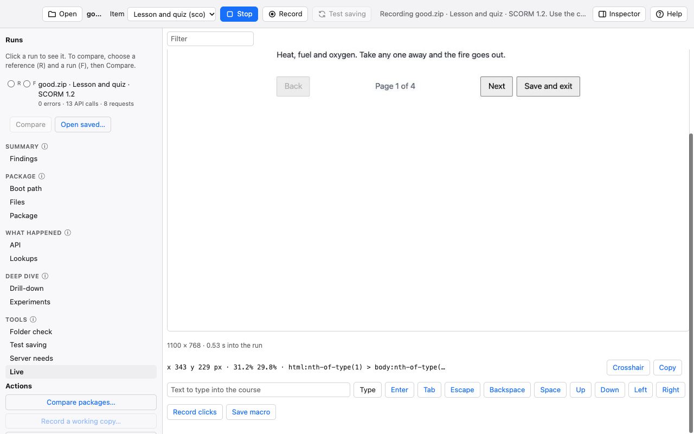

# Views

The sidebar lists the views of the selected run. Each section below says what a view shows and what its buttons do, in the order of the sidebar.

## The sidebar

- **Runs** (top): every run in this session, plus any saved runs you open. Click one to show it. **R** and **F** mark a reference run and a failing run, for comparing.
- With no run selected, the views show the package as read from its files. With a run selected, they show that run.
- **Views**: five groups, **Summary**, **Package**, **What happened**, **Deep dive** and **Tools**. Click a view to show it; the chosen one is highlighted. With the list focused, **↑** and **↓** move through the views, and **⌘1** to **⌘5** (Ctrl+1 to Ctrl+5 off a Mac) jump to the first view of each group.
- A view with nothing to show is left out of the list, and so is a group with nothing in it. **Findings**, **Boot path**, **API** and **Lookups** always show, and so do the views you start things from: **Experiments**, **Test saving**, **Server needs**, **Drill-down**, **Folder check** and **Live**. The **Filter** box above the view narrows whichever table is showing.
- **Actions** (bottom): **Compare packages…**, **Record a working copy…**, **Check a folder…** (desktop only) and **Export corrected package…**.

## Summary

### Findings

The banner, the **Milestones** strip, then the findings, worst first. At the bottom is **Save report…**, with **Take the course content out** ticked for a redacted report. See [Reading a run](reading-a-run.md) and [Sending a report](changing-and-exporting.md#sending-a-report-without-the-course-content).

### Timeline

One run on one time axis: milestones, requests, scripts, API calls, errors and what showed, together. See [Timeline](reading-a-run.md#timeline).

## Package

### Boot path

The loading path of the selected item, and in a run, when each file was asked for. See [Boot path](reading-a-run.md#boot-path).

### Files

The package's files as a tree, with a text editor. **Save as override**, **Revert**, **Replace from a file…**, **Show changes** and **Revert all** are for testing a change without touching the course. See [Changing files](changing-and-exporting.md#changing-files-and-running-again).

### Package

The manifest, the items, and every match from the static scan of the scripts (API names, searches, requests, server paths, mode switches). Each line number opens the code.

## What happened

### API

Every SCORM API call in order (element, value, result, error), and the stored values at the end. It fills in while the course runs.

### xAPI

For a cmi5 or Tin Can run: the statements, their validation, the documents and the requests to the LRS. See [The xAPI tab](other-formats.md#the-xapi-tab).

### Network

Every request, with its status, type and the code that made it. **Answer this request…** appears on failed and server requests. See [Pins and answers](changing-and-exporting.md#pins-and-answers).

### Errors

Uncaught errors, caught errors (if **Record caught errors** is on) and browser warnings, in time order, with where each happened.

### Console

The content's console output.

### Frames

Frame navigations and their targets: cross-origin frames, workers and popups.

### Lookups

Every time the content read `window.API` or `window.API_1484_11`, in any frame, with whether it found one and the code that looked. Pins appear here too: each read of a pinned value, and each try to change one. It also shows the frame depth and opener of each frame, and any assignment to those names.

### Scripts

Every script the browser read, in order, with what loaded it. **Code** opens it in the [code view](reading-a-run.md#reading-the-code).

## Deep dive

### Execution

For a traced run, the last events before the run went quiet, with the filter box to narrow them. **Code** opens the line. See [Tracing the code](experiments-and-servers.md#tracing-the-code).

### Drill-down

Why the run stopped, as a chain of decisions. **Drill down** runs the item again if it has to, and **Stop** ends a run in progress. See [Drill-down](experiments-and-servers.md#drill-down).

### Experiments

A preset, **Run all** and **Stop**, and a table that fills in as each variant finishes. See [Experiments](experiments-and-servers.md#experiments).

## Tools

### Compare

A comparison of the reference (R) and a failing run (F). See [Comparing with a working copy](experiments-and-servers.md#comparing-with-a-working-copy).

### Package diff

The comparison of two packages, from their files. See [Comparing two packages](changing-and-exporting.md#comparing-two-packages).

### Folder check

The result of **Check a folder…**, one row per package. Click a row to open that package. Desktop app only. See [Checking a folder](changing-and-exporting.md#checking-a-folder-of-packages).

### Test saving

The two runs of a save-and-resume test, side by side, with **Test saving** and **Stop**. See [Test saving](macros.md#test-saving).

### Server needs

The server requests of the run, with **Discover all server requests**, **Rounds**, **Discover** on each request, **Save as response** and **Stop**. See [Server needs](experiments-and-servers.md#server-needs).

### Live

The course window as it runs, in Package Lab (desktop app and web interface). It is listed while a run is going, and **Show in Package Lab** in the toolbar opens it. Click the picture to click the course; with the picture focused, keys go to the course too.



Under the picture, the coordinates bar follows the pointer:

```
x 412  y 233 px · 37.5% 29.1% · button#next “Next”      [Crosshair] [Copy]
```

The pixels are in the course window's own size, and the percentages are the same position as fractions across it, which is what a macro's click holds. The last part is the element under the pointer: its role and id, or its selector, and its text. **Crosshair** draws guide lines through the pointer. **Copy** (or ⌘C with the picture focused) copies `x=412 y=233 (37.5%, 29.1%)`, with the selector on a second line when it is known, and says “Copied”. For the web interface, see also [Live view](../web.md#live-view).

## On the command line

Most views have a command that gives the same answer as text or JSON: [run](../cli.md#run) for the findings, API and milestones, and [experiment](../cli.md#experiment), [discover](../cli.md#discover), [drill](../cli.md#drill), [cycle](../cli.md#cycle), [diff](../cli.md#diff) and [batch](../cli.md#batch) for the views of the same names.
