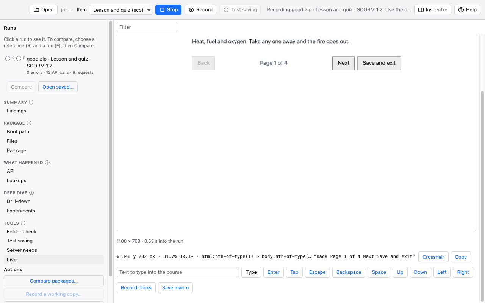
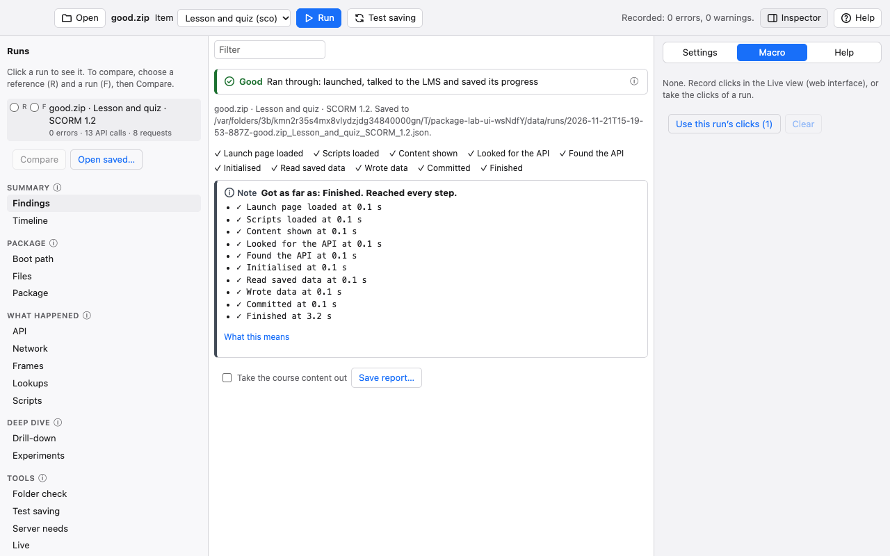

# 9. Macros: playing the learner

**What you'll learn:** how to make Package Lab click through a course for you, the same way every time. You'll record
a macro, read and edit it, add waits so it doesn't click too soon, see how clicks follow their button when the layout
changes, and read and write macro files.

## Why macros matter

Some faults only show after a learner has done something: moved a few pages, answered a question, left part-way. You
can do that by hand once. But an analyst runs a course ten or twenty times while testing theories, and needs every run
to do the same thing, or the runs can't be compared. A **macro** is a list of clicks, keys, typed text, scrolls and
waits that Package Lab plays into the course during a run. Every run plays it identically.

Macros are needed for the save-and-resume test ([chapter 10](10-saving-and-resuming.md)), and they're useful for any
fault that only appears on page 5.

## Four ways to make one

| Way | Where | Best for |
|---|---|---|
| **Record** | The toolbar, while a run goes (⌥⌘R) | The usual way |
| **Record clicks** | The **Live** view | Seeing exactly where each click lands; the web interface |
| **Use this run's clicks** | The inspector's **Macro** segment, after a run | You used the course and only afterwards wished you'd recorded it |
| **A file** | **Import…** in the Macro segment, or `--macro` on the command line | Macros written or edited by hand, shared, or kept with a project |

### Recording with Record

1. Set **Stop after** to **I stop it**, and **Run**.
2. Choose **Record** in the toolbar. It reads **Recording…**.
3. Click through the course as a learner would, in the course's own window (not Package Lab's).
4. Choose **Record** again, or **Stop**. Package Lab asks “Save 6 steps as the macro?”. **Save** replaces the macro
   you had; **Discard** keeps it.

Only clicks made after you pressed **Record** are kept.

### Recording in the Live view

**Live** (in the sidebar's **Tools** group; or **Show in Package Lab** in the toolbar while a run goes) shows the
course window inside Package Lab. Click the picture and the click goes to the course; with the picture focused, keys go
to it too.



Under the picture, the **coordinates bar** follows the pointer:

```
x 412  y 233 px · 37.5% 29.1% · button#next “Next”      [Crosshair] [Copy]
```

The pixels are in the course window's own size; the percentages are the same point as fractions across the window,
which is what a macro stores; the last part is the element under the pointer. **Crosshair** draws guide lines, and
**Copy** (⌘C) copies the position and the element's selector, handy when you're writing a macro by hand.

Choose **Record clicks**, use the course through the picture, then **Save macro**. This is also how you record in the
[web interface](14-working-at-scale.md#the-web-interface-package-lab-from-another-device), from an iPad or another
computer.

## Reading a macro

The inspector's **Macro** segment shows the macro as a table:

| # | When | Action | Where |
|---|---|---|---|
| 1 | +0.5 s | Click | 165, 80 `#next “Next”` |
| 2 | +0.4 s | Click | 165, 80 `#next “Next”` |

- **When** is the time since the step before, or, for a wait, what it waits for.
- **Where** is the position, in pixels at the size the macro was recorded at, and the element the click was made on.
- Above the table: how many events, over how long, “recorded at 1100×800”.



## What a macro remembers

**The element, as well as the position.** A click is saved with the element it hit: a selector (`#next`), its role and
up to 60 characters of its text. When the macro plays, the click goes to that element *wherever it is now*, if exactly
one element matches and can be seen. Only if it can't be found does the click fall back to its recorded position, and
the run gets the note “2 clicks didn't find their element and used their recorded position”.

**The window size.** Positions are fractions across the window, so a macro remembers the size it was recorded at, and
a run with no **Device size** of its own plays at that size. If you choose a different size, yours wins, and the run
notes “The macro was recorded at 1100×800 and played at 390×844: clicks may miss”.

**Typed text, only if you asked.** Text typed in the course is kept only if **Keep typed text in runs (for macros)**
(**Settings › Recording**) was ticked, and never from a password field or a card or one-time-code field. Text typed
through the Live view while **Record clicks** is on *is* kept, so don't type secrets there.

**Not pointer moves.** Recording drops them. It stops at 2,000 events or 100 KB of text.

## Waits: the cure for clicking too soon

Timing is the commonest reason a macro misses. A button that appears after a slow request, an animation or a
three-second intro isn't there when the click comes. A **wait** step blocks the macro until something has happened:

| Wait for | Means |
|---|---|
| **Text** | Some text appears on the page, in any of the course's frames |
| **A milestone** | The run reaches a step, such as *Initialised* |
| **Quiet network** | No request has been pending for so long |
| **A time** | Some milliseconds, no matter what |

A text, milestone or quiet wait gives up after its timeout (30 s unless you set another). Then the macro stops there,
the run says “The macro stopped at step 1: waited 30 s for “Next” and it never appeared”, and carries on to its end.

**Add wait** puts a wait after the chosen row (at the end if none is chosen). Use **↑** to move it earlier.

Prefer waiting for *something* (text, a milestone) over waiting for a *time*. A time that works on your Mac is too
short on a slow LMS.

## Editing

Choose a row (click it, or Tab to it and press Enter) to change it in the form below the table. **↑** and **↓** move a
step, **✕** deletes it. Changing a step's delay moves every later step by the same amount, so the rest keeps its
timing.

While a run is going, **Play step**, **Play from here** and **Play to here** play part of the macro into the course,
so you can try a change without a whole run.

## Keeping macros

**The current macro plays at the start of every run** until you **Clear** it or close the app. That's easy to forget.
If runs start clicking things you didn't expect, look at the **Macro** segment.

To keep one:

- **Save As…** names it and keeps it for this package (in the data folder's `macros/`). The menu at the top of the
  segment lists a package's saved macros; choose one to load it.
- **Export…** writes it to a file; **Import…** reads one. Neither changes your saved macros until you **Save As…**.

Macros need Chromium. With **Browser: WebKit**, the run says the macro wasn't played.

## Macro files

A macro file is JSON. You'll rarely write one from scratch, but reading one helps, and editing one is sometimes
quicker than re-recording:

```json
{ "format": "package-lab-macro", "version": 2, "viewport": { "width": 1100, "height": 800 }, "events": [
  { "t": 400, "type": "wait", "text": "Next", "timeout": 10000 },
  { "t": 500, "type": "click", "x": 0.15, "y": 0.1,
    "target": { "sel": "#next", "text": "Next", "role": "button", "frame": [0] } }
] }
```

- `t` is milliseconds since the run started; the gap between two events is the pause between them.
- `x` and `y` run from 0 to 1 across the window recorded in `viewport`.
- `target` ties a click to its element: `sel` is a CSS selector, and `frame` the frames to go down from the top
  window. Edit `sel` to point a click at another element.
- Other types are `key` (`Enter`, `Tab`, arrows…), `text`, `wheel` and `move`.

To print a macro file as the editor's table:

```bash
package-lab macro show macro.json
```

The full format is in the [command line reference](../cli.md#macros).

## Try it: record one

1. Open `01-works.zip`. Run it with **I stop it**, choose **Record**, choose **Next** twice, then **Record** again
   and **Save**. Stop the run.
2. Read the **Macro** segment. How many steps? What element is each click tied to? What size was it recorded at?
3. **Run** again with **10 s**, and don't touch anything. In **API**, what was the last `cmi.core.lesson_location`
   written?
4. **Save As…** `two-pages`. You'll use it in the next chapter.

## Try it: `14-next-button-late.zip`

*“Our automated test clicks Next and nothing happens.”*

The practice kit includes a macro for this package, `14-next-button-late.macro.json`.

1. Open `14-next-button-late.zip`. In the **Macro** segment, choose **Import…** and pick the macro file. Read it: when
   do the clicks come?
2. Run it for 10 seconds. In **API**, how far did the lesson location get? Did the clicks do anything?
3. Use **Live**, or run with **I stop it** and watch the course window. When does **Next** appear?
4. Choose **Add wait**, set it to wait for the text `Next`, and move it to the top with **↑**. Run again. Now how far
   does the location get?

Check your answer in [the answers](appendix-a-answers.md#14-next-button-late).

## Try it: `15-button-moves.zip`

*“The macro works on my screen but not on the test machine.”*

1. Open `15-button-moves.zip` and **Import…** `15-button-moves.macro.json`. Run for 10 seconds. Does it move pages?
2. Set **Device size** to **iPhone** and run again. Read the note about the size. Did the clicks still work? Why?
3. Now break the tie: **Export…** the macro, open the file in a text editor, change both `"#next"` to `"#nope"`, save
   it and **Import…** it again. Run at **iPhone** size. Did it still work? Read the notes.
4. Set **Device size** to **Custom size…** 2400 × 800, and run again. What happened this time? Where is **Next** at
   that width, compared with where the macro's position says?
5. Put **Device size** back to **Window as it is**, and **Clear** the macro.

Check your answer in [the answers](appendix-a-answers.md#15-button-moves).

## Check yourself

1. Why does an analyst want a macro, even for a course they could click through by hand?
2. A click's element can't be found. What does Package Lab do, and how do you know it happened?
3. Your macro works at 1100 × 800 but not on an iPad size. Name two possible reasons.
4. Why is “wait for text *Next*” better than “wait 3 seconds”?
5. Every run since lunch has been clicking through the course by itself. Why?

Next: [Saving and resuming](10-saving-and-resuming.md).
