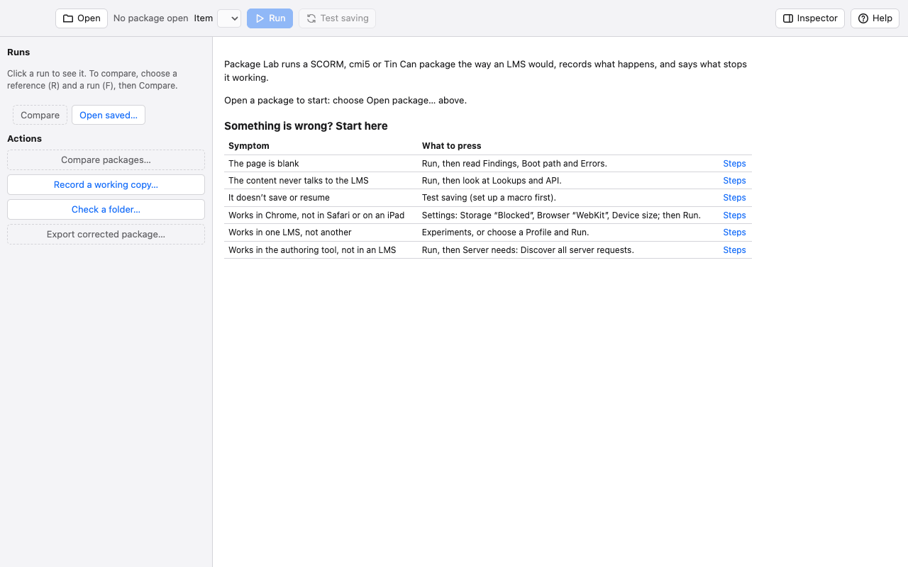
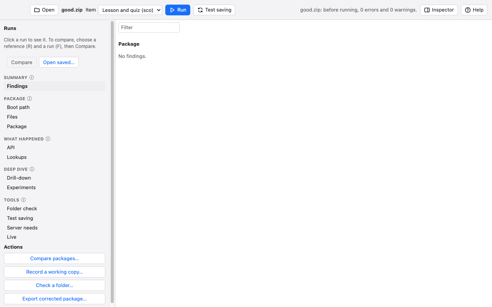
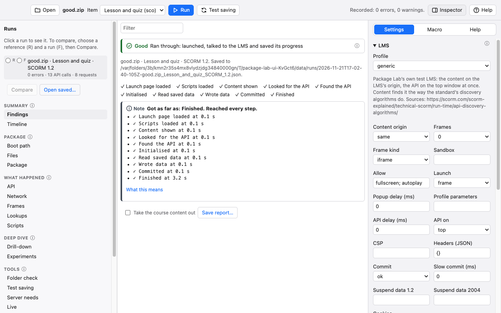
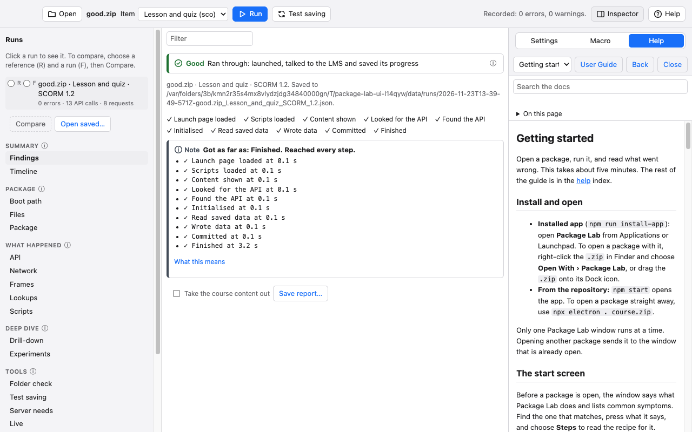

# 4. A tour of the window

**What you'll learn:** where everything is, what each part of the window is for, and how to get help from inside the
app. Don't try to remember it all: come back here when a later chapter mentions something you can't find.

## The start screen

With no package open, the window explains what Package Lab does and lists the usual symptoms, each with what to press
and a **Steps** link to the recipe for it.

When you have a real course with a real problem and no idea where to start, start here. Find the symptom, do what it
says, and read the steps.

## Opening a package

Any of these opens a package:

- **Open package…** in the toolbar, or **File › Open Package…** (⌘O);
- drag the `.zip` onto the window (it says **Drop to open**) or onto the Dock icon;
- right-click the `.zip` in Finder and choose **Open With › Package Lab**;
- **File › Open Recent**.

Package Lab reads the ZIP in memory and never unpacks it to disk. The static findings appear at once.

**Try it.** Open `01-works.zip` from your practice folder.

## The three parts of the window

### The toolbar (along the top)

From left to right:

- **Open** and the package's name. (The **File** menu calls it **Open Package…**.)
- **Item**: which item of the package to launch. The first SCO is chosen for you.
- **Run** (⌘R), which becomes **Stop** (⌘.) while a run goes.
- **Record** (only while a run goes): records your clicks as a macro ([chapter 9](09-macros.md)).
- **Test saving** (⇧⌘R): the save-and-resume test ([chapter 10](10-saving-and-resuming.md)).
- The **summary chip**, beside Run: a short list of the settings you've changed from their defaults, such as
  “SCORM 2004, Moodle, iPhone”. It's hidden when everything is at its default. Click it to see those settings.
  **Glance at it before every run**: a setting left over from an earlier test is the most common reason a run
  surprises you. Most settings are remembered even after you quit: **API**, **Profile**, **Frame depth**, **In a new
  window**, **Stop after**, **Record caught errors**, **Storage**, **Browser**, **Device size** and **Trace the code**.
  The **Item**, **Resume last run's data**, pins, answers and the macro are not.
- The **status line**: what Package Lab is doing, and the count of errors and warnings.
- **Inspector** (⌥⌘I) and **Help**, at the right.

### The sidebar (left)

At the top, **Runs**: every run of this session, newest first, and any saved runs you open. Click one to show it. With
no run selected, the views show the package as read from its files; with a run selected, they show that run. This
matters: the same view, **Boot path** say, shows different things before and after a run. Once you've run a package,
a run stays selected; to see the files-only views again, open the package again (**File › Open Recent**).

Under **Runs** are **Open saved…** (runs from earlier sessions, or from the command line) and the **R** and **F**
marks, which set a reference run and a failing run to compare ([chapter 12](12-going-deeper.md#comparing-with-a-working-copy)).

Below that, the **views**, in five groups. You'll meet each one in the chapter shown.

| Group | Views | What they answer | Chapter |
|---|---|---|---|
| **Summary** | Findings, Timeline | What went wrong? What happened when? | 5, 6 |
| **Package** | Boot path, Files, Package | What's in the package, and how should it load? | 6, 8 |
| **What happened** | API, xAPI, Network, Errors, Console, Frames, Lookups, Scripts | What did the course actually do? | 6 |
| **Deep dive** | Execution, Drill-down, Experiments | Why did it do that? | 8, 12 |
| **Tools** | Compare, Package diff, Folder check, Test saving, Server needs, Live | Tests and comparisons you start | 9, 10, 12, 13 |

A view with nothing to show is left out of the list (the xAPI view appears only for cmi5 and Tin Can runs, for
example). ⌘1 to ⌘5 jump to the first view of each group, and ↑ and ↓ move through them. The **Filter** box above a
view narrows whatever table it shows.

At the bottom, **Actions**: **Compare packages…**, **Record a working copy…**, **Check a folder…** and **Export
corrected package…** ([chapter 13](13-delivering-the-answer.md)).

### The inspector (right)

**Inspector** in the toolbar (⌥⌘I) opens a panel with three segments:

- **Settings**: everything the next run will use, in four groups: **LMS**, **Browser and device**, **Recording** and
  **Advanced**. Chapters [8](08-testing-a-theory.md) and [10](11-browsers-devices-and-lmss.md) cover them.
- **Macro**: the clicks and keys Package Lab plays into the course ([chapter 9](09-macros.md)).
- **Help**: the docs, including this guide.

Drag the inspector's left edge to make it wider. It remembers its width and which segment was open.

## Getting help inside the app

There are two kinds of help, for two different moments.

**Help**, in the toolbar (or ⇧⌘H), is for while you work. It opens the reference in the inspector, beside the window:
what each view, button and setting does. You can search it as you type, and **On this page** lists the headings of the
page you're reading. The small **ⓘ** beside a settings group, a view group and the verdict opens the part of Help that
explains it, and **What this means** on a finding opens its explanation.

**The User Guide**, which you're reading, is for learning. It has a window of its own (**Help › User Guide**, ⇧⌘G,
or **User Guide** at the top of the Help panel), so you can keep a chapter open beside Package Lab while you do its
exercises. See [About this guide](README.md#reading-it-in-the-app) for what its window does.

Both are inside the app, so they work offline.

## The menus

| Menu | What's there |
|---|---|
| **Package Lab** | **Settings…** (⌘,): Appearance (System, Light or Dark) and the web interface's port |
| **File** | Open, Open Recent, Compare Packages, Check a Folder, Open Saved Run, Record a Working Copy, Export Corrected Package (⌘E) |
| **Run** | Run (⌘R), Stop (⌘.), Record Macro (⌥⌘R), Test Saving (⇧⌘R) |
| **View** | Show Inspector (⌥⌘I), Reload (⇧⌥⌘R) |
| **Help** | User Guide (⇧⌘G), Show Help (⇧⌘H), Help Topics, Recipes, Findings, Show Data Folder |

## The shortcuts worth learning now

| Keys | Does |
|---|---|
| ⌘O | Open a package |
| ⌘R | Run |
| ⌘. | Stop |
| ⌥⌘I | Show or hide the inspector |
| ⌘1 to ⌘5 | Jump to a view group |
| ⇧⌘H | Help |
| ⇧⌘G | User Guide |

## Check yourself

1. With no run selected, what do the views show?
2. Where do you look to see which settings the next run will use, without opening the inspector?
3. You can't see the **xAPI** view in the sidebar. Is something wrong?
4. How do you find the explanation of a finding you don't understand?

Next: [Your first run](05-first-run.md).
