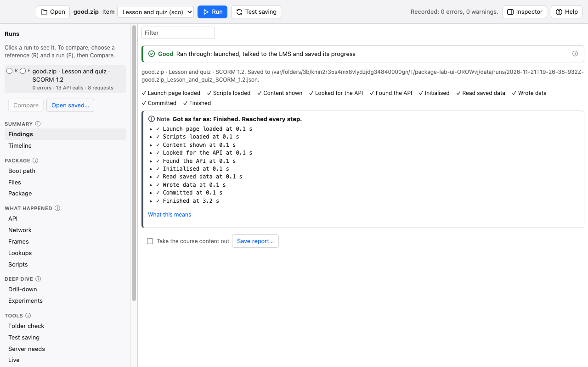

# 5. Your first run

**What you'll learn:** how to open a package, run it, use it as a learner would, and read the verdict. You'll use
`01-works.zip`, which has nothing wrong with it, so you learn what a good run looks like before you meet a bad one.

## Step 1: open the package and read the static findings

Open `01-works.zip` (⌘O, or drag it onto the window). Package Lab reads the files and fills **Findings** at once.

For this package the list is empty, and the status line says there are no errors or warnings. That means the manifest
is where it should be, every file it names is in the ZIP with the right capitals, the scripts use the same SCORM version
the manifest declares, and every file the launch page loads is there.

Look at the **Item** menu in the toolbar. It shows *Lesson and quiz*, the first SCO. The package has a second item,
*Glossary*, which is an asset: it doesn't track, so it isn't chosen.

## Step 2: choose how the run ends

Open the inspector (⌥⌘I) on **Settings**, and find **Stop after** in the **Recording** group. It has two kinds of
choice:

- **I stop it**: the run lasts until you press **Stop** or close the course window. Use this when you want to use the
  course yourself.
- **A time** (10 s to 5 min): Package Lab stops by itself and analyses the run. Use this for a quick look, or when the
  course is broken and won't get anywhere anyway.

Choose **I stop it** for now. Leave every other setting as it is.

## Step 3: run it and use it

Choose **Run** (⌘R). The course opens in a window of its own, with Package Lab playing the LMS. Back in the main
window, the **API** view fills in as the course talks to the LMS.

The course's first line greets you by name (the test LMS's learner is *Learner, Test*) and shows what it read from
the LMS: entry `ab-initio`, status `not attempted`. Then, as a learner would:

1. Choose **Next** three times, to reach the quiz on page 4.
2. Answer the three questions on the quiz page, and choose **Submit answers**.
3. Choose **Save and exit**.
4. Close the course window, or choose **Stop** in Package Lab.

Package Lab now collects what it recorded, works out the findings, saves the run, and selects it in **Runs**.

## Step 4: read the verdict

**Findings** now starts with a banner. It has one word and one sentence:

- The word is **Problem**, **Warning** or **Good**: the worst finding of the run. **Good** means no problem and no
  warning.
- The sentence says how far the run got. “Ran through” means it reached every milestone. Otherwise it says
  “Got as far as “…”, but didn't reach “…”.”

Under the banner is the **Milestones** strip, then the findings, worst first.

### The milestones

Each of the ten steps has a tick or a cross. Hover over one to see what showed it.

| # | Milestone | Reached when |
|---|---|---|
| 1 | Launch page loaded | The launch page came back successfully |
| 2 | Scripts loaded | Every script the page names was requested, and none failed |
| 3 | Content shown | Some frame showed at least 20 characters of text, or an image or other media |
| 4 | Looked for the API | The content searched for the SCORM API |
| 5 | Found the API | It found one |
| 6 | Initialised | `LMSInitialize` or `Initialize` returned true |
| 7 | Read saved data | It read the entry, the location or the suspend data |
| 8 | Wrote data | It set the location, suspend data, status, score or completion |
| 9 | Committed | A commit returned true |
| 10 | Finished | `LMSFinish` or `Terminate` returned true |

These are the healthy session from [chapter 2](02-elearning-basics.md#a-healthy-session), step by step. Learn them: from
now on, “where did it stop?” is the first question you ask of every run.

### The findings

Each finding is a card with a severity (**Problem**, **Warning** or **Note**), a title, an explanation, the
**evidence** (a file and line, or what happened) and **Try:**, what to do. **What this means** opens the full
explanation in the docs panel.

The three severities have other names outside the window, and you'll meet both:

| In the window | In the command line, reports, the folder check and the [findings reference](../findings.md) |
|---|---|
| **Problem**: this will stop it working | **error** (`ERROR`) |
| **Warning**: it may stop it working, or has a side effect worth knowing | **warning** (`WARNING`) |
| **Note**: context | **info** (`INFO`) |

This guide says *Problem* when you're in the window, and *error* when it quotes the command line.

## Step 5: see what a timed run says

Now do it the quick way. Set **Stop after** to **10 s**, choose **Run**, and don't touch the course window. After ten
seconds, Package Lab stops by itself.

This time the banner says **Warning**, with “Got as far as “Committed”, but didn't reach “Finished”.” And there are two
findings you didn't get before:

- **The content never called LMSFinish** (a warning);
- **The content never set exit** (a note).

Nothing is wrong with the course. Nobody left it, so it never had the chance to finish. Both findings say as much in
their explanation.

This is the first lesson of reading a run: **a finding describes what happened in this run, not a fault in the
course.** A timed run that nobody used will always stop before *Finished*. Before you report a fault, ask whether the
run gave the course a fair chance to do the thing it's accused of not doing.

## Step 6: look at the runs

**Runs**, at the top of the sidebar, now has two runs. Click between them: every view changes to show the run you've
chosen. To see what the files alone say again, open the package again (**File › Open Recent**).

Every run is saved, so you can open it again later with **File › Open Saved Run…**.

## Try it

1. Run `01-works.zip` with **I stop it**, go to page 3, choose **Save and exit**, and stop. Which milestones did it
   reach? Is there a note about exit? (There shouldn't be: **Save and exit** sets exit to `suspend`.)
2. Run it again with **10 s** and compare the two runs' banners. Which findings appear in one and not the other, and
   why?
3. Open the **API** view on your first run and find the call that set `cmi.core.score.raw`. What score did you get?

## Check yourself

1. What does the banner's word tell you, and what does its sentence tell you?
2. A timed run of a course says “The content never called LMSFinish”. Is the course broken?
3. Which milestone would you look at first for a course that shows a blank page?
4. How do you go back to looking at what the package's files alone say?

Next: [Reading the evidence](06-reading-the-evidence.md).
